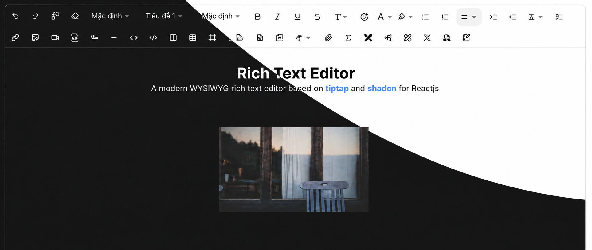
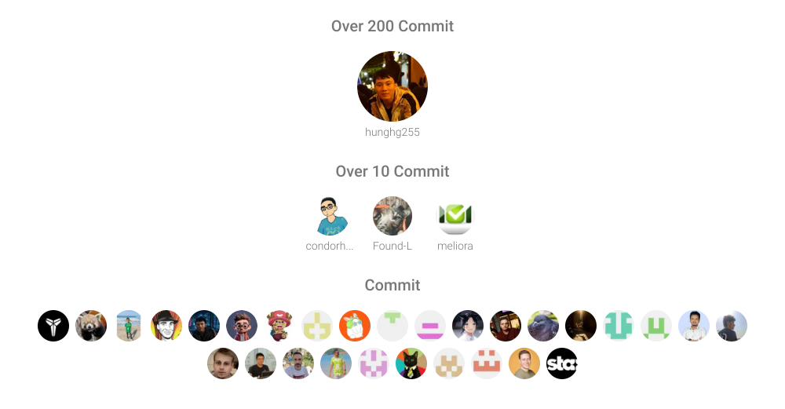

> **SAP Studio 在线演示**：https://caovc.github.io/reactjs-tiptap-editor/sap/ — 基于 ReUI 的统计分析计划编辑器，功能与边界见 [docs/sap](docs/sap/README.md)。

> **ReUI migration fork** of [hunghg255/reactjs-tiptap-editor](https://github.com/hunghg255/reactjs-tiptap-editor).
> Correction: the initial 15-family replacement was not a complete product-UI migration. The whole-source completion now uses 18 pinned official ReUI v1 families across the shared editor and plugin-owned UI; necessary native/third-party engine boundaries remain explicitly documented.
> [Migration map and provenance](docs/reui/MIGRATION.md) · [Full file-level audit](docs/reui/FULL_AUDIT.md) · [Current verification](docs/reui/VALIDATION_COMPLETION.md) · [Playground](https://caovc.github.io/reactjs-tiptap-editor/)
> npm publishing is disabled for this independent fork.

<p align="center">
<a href="https://www.npmjs.com/package/reactjs-tiptap-editor" target="_blank" rel="noopener noreferrer">
</a>
</p>

<p align="center">
 A Tiptap block editor with official ReUI components, based on the MIT-licensed upstream editor.
</p>

<p align="center">
  <a href="https://www.npmjs.com/package/reactjs-tiptap-editor" target="_blank" rel="noopener noreferrer"></a>
  <a href="https://www.npmjs.com/package/reactjs-tiptap-editor" target="_blank" rel="noopener noreferrer"></a>
  <a href="https://bundlephobia.com/result?p=reactjs-tiptap-editor" target="_blank" rel="noopener noreferrer"></a>
  <a href="https://github.com/hunghg255/reactjs-tiptap-editor/graphs/contributors" target="_blank" rel="noopener noreferrer"></a>
  <a href="https://github.com/hunghg255/reactjs-tiptap-editor/blob/main/LICENSE" target="_blank" rel="noopener noreferrer"></a>
</p>



## Demo

[Playground](https://caovc.github.io/reactjs-tiptap-editor/) · [SAP Studio](https://caovc.github.io/reactjs-tiptap-editor/sap/)

## Documentation

[Documentation](https://reactjs-tiptap-editor.vercel.app/)

For the current source API, see [Getting Started](./docs/guide/getting-started.md), [individual bubble imports](./docs/guide/bubble-menu.md), and [selective locale loading](./docs/guide/internationalization.md). Bundle measurements and before/after comparisons are in the [optimization report](./reports/bundle-size/REPORT-ROUND2.md).

## Deep wiki

[Deep Wiki](https://deepwiki.com/hunghg255/reactjs-tiptap-editor)

## Run Locally

Clone the project

```bash
git clone https://github.com/caovc/reactjs-tiptap-editor.git
```

Go to the project directory

```bash
cd reactjs-tiptap-editor
```

Install dependencies

```bash
pnpm install
```

Start the Demo server

```bash
npm run build:lib:dev
npm run playground
```

## All Contributors

Thanks to the following friends for their contributions to project:



## Star History


## Related

Here are some related projects

[Tiptap](https://tiptap.dev)

[Shadcn](https://ui.shadcn.com/)

## License

[MIT](./LICENSE)

## Sponsors

<p align="center">
  <a href="https://cdn.jsdelivr.net/gh/hunghg255/sponsors/sponsors.svg">
    
  </a>
</p>
